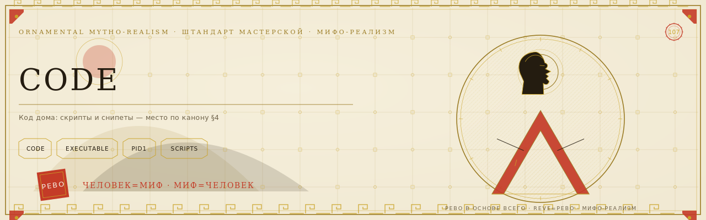
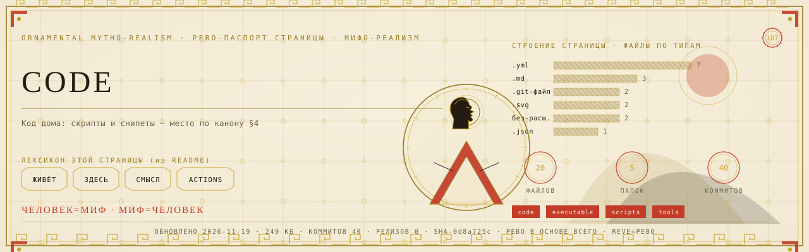

  

<!--ФОРЖ:ПАСПОРТ:НАЧАЛО-->

  

| ФАЙЛОВ | ПАПОК | КОММИТОВ | ОБНОВЛЕНО | РЕЛИЗОВ |
|---:|---:|---:|---|---:|
| 28 | 6 | 70 | 2026-11-20 | 0 |
<!--ФОРЖ:ПАСПОРТ:КОНЕЦ-->

  

# code — КОД ДОМА

> заведён 2026-11-16 по явной команде Хозяина; канон §4: место для кода — code
> 1 смысл = 1 репо: это библиотека ПЕРЕИСПОЛЬЗУЕМОГО КОДА, не знаний и не адресов

## Что здесь живёт

| раздел | смысл |
|---|---|
| `scripts/` | самостоятельные скрипты: API-обходчики, верификаторы, хоз-утилиты |
| `snippets/` | проверенные куски: паттерны, шаблоны, конфиги под задачу |

## Правила

- Каждый файл — самодостаточный: шапка с назначением, зависимостями и примером вызова.
- Код с секретами не живёт здесь вообще (I-5): секреты — только в Actions secrets.
- Заимствованный код помечен происхождением (ссылка на источник), чужие лицензии уважаются.
